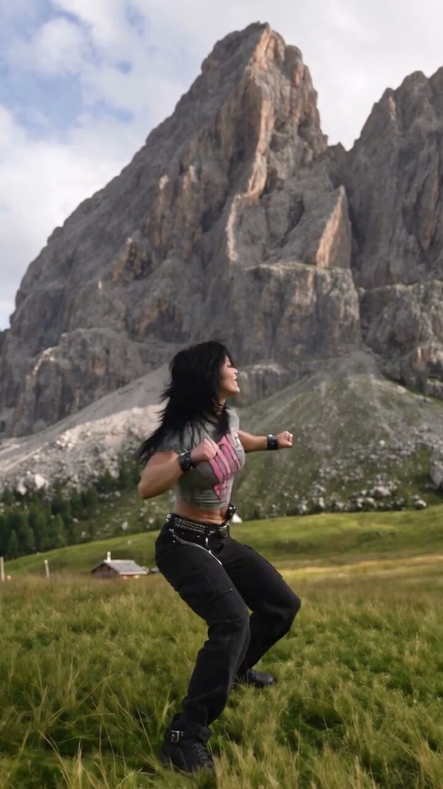
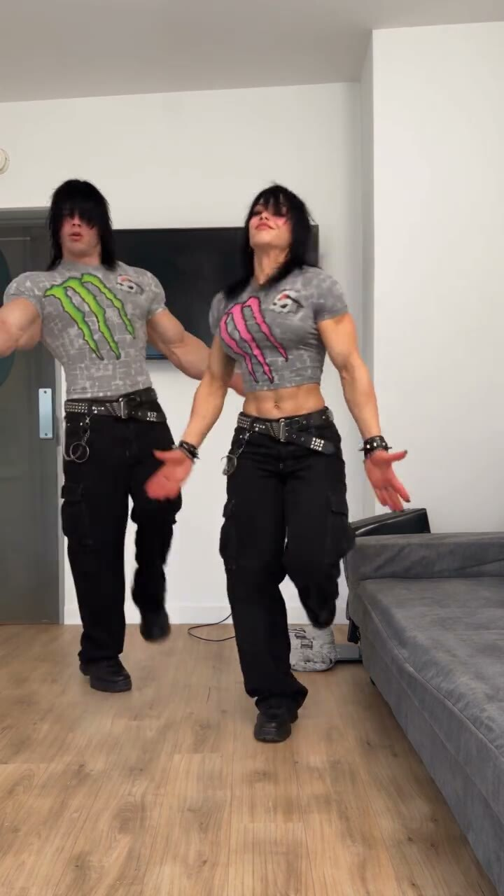
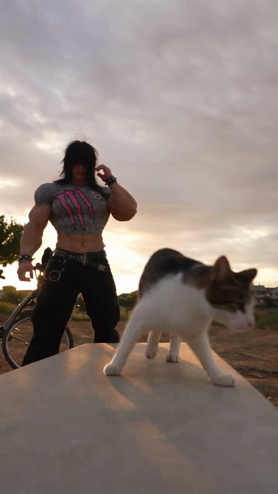
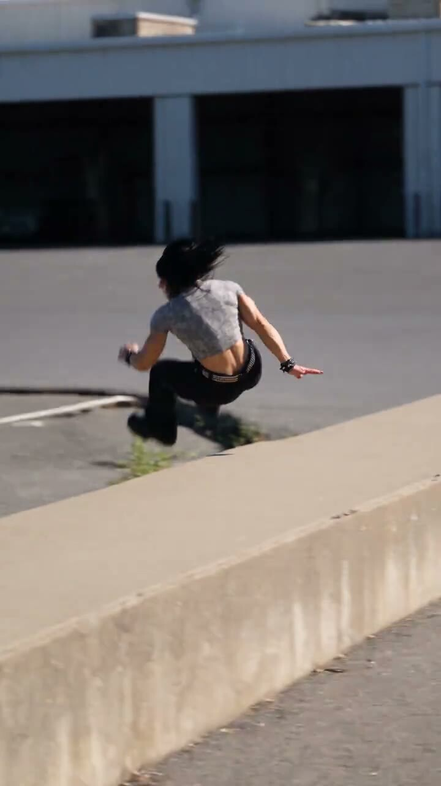

  

  <a href="https://www.tiktok.com/@erika.mercer">TikTok</a> &nbsp;·&nbsp;
  <a href="https://www.instagram.com/erika.mercer2006/">Instagram</a>

### Meet Erika

Erika Mercer is an AI character built for short-form stories with a little chaos. One moment it's a dance-off; the next it's a mountain, a cat, or a challenge nobody asked for. The look stays unmistakable: dark hair, a bold **M**, and main-character energy.

<strong>AI character &nbsp;✦&nbsp; Visual storytelling &nbsp;✦&nbsp; Made with Higgsfield</strong>

### Frames from the story

<table>
  <tr>
    <td align="center"> Sunset energy</td>
    <td align="center"> The face behind the M</td>
    <td align="center"> Move mountains</td>
  </tr>
  <tr>
    <td align="center"> Runs in the family</td>
    <td align="center"> Scaredy cat?</td>
    <td align="center"> Mercer genetics</td>
  </tr>
</table>

### Start watching

<a href="https://www.tiktok.com/@erika.mercer/video/7694616778479029534">Mercer genetics</a> · <a href="https://www.tiktok.com/@erika.mercer/video/7693489904881241357">Runs in the family</a> · <a href="https://www.tiktok.com/@erika.mercer/video/7695000440500407583">F around and find out</a>

Fictional character. Real creative work. More to come.

