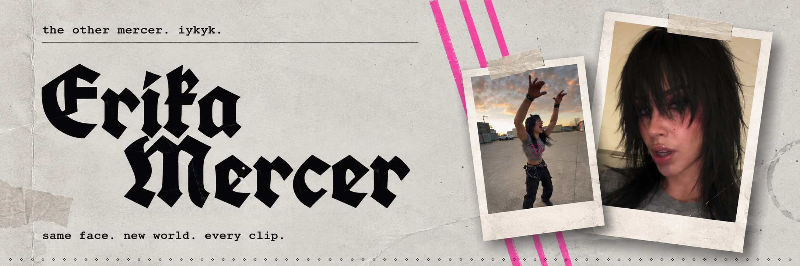
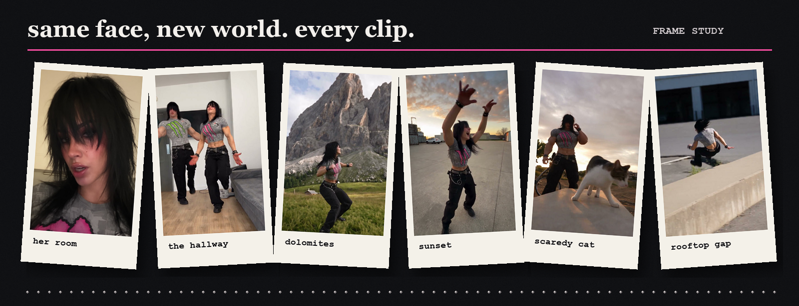
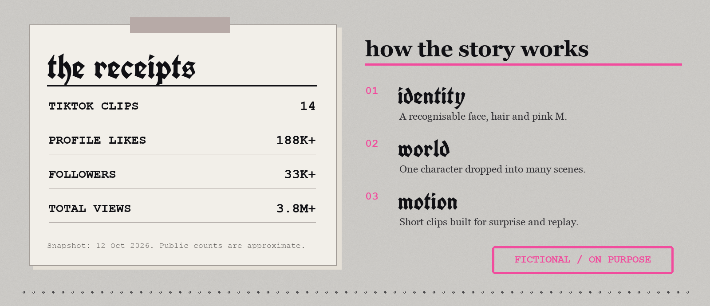
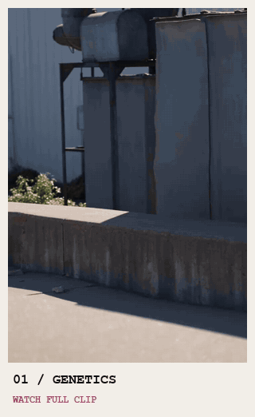
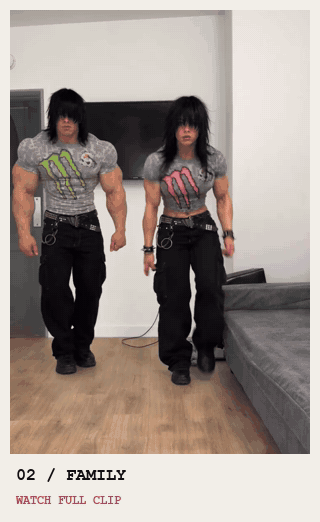
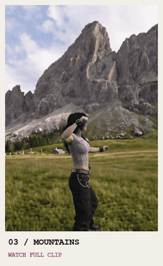

  

  <a href="https://www.tiktok.com/@erika.mercer"><strong>TIKTOK ↗</strong></a>
  &nbsp;&nbsp; / &nbsp;&nbsp;
  <a href="https://www.instagram.com/erika.mercer2006/"><strong>INSTAGRAM ↗</strong></a>
  &nbsp;&nbsp; / &nbsp;&nbsp;
  <a href="https://erikamercer.club/"><strong>ERIKA CLUB ↗</strong></a>

<em>She doesn't exist. Her stories do.</em>

  

### the character

Erika Mercer is a fictional, AI-created character with a look you can spot in a second: dark hair, a bold **M**, black cargos and a taste for improbable situations. She can be in a quiet room, on a mountain, beside a cat or mid-challenge — and still feel like the same person in the same unfolding story.

The clips are short, playful and built around one simple idea: **a familiar face in an unfamiliar scene**. Dance, rivalry, tiny jokes and impossible moments keep the world moving.

  

### watch Erika move

<em>Three scenes. Press a preview to watch the full clip with sound.</em>

<table>
<tr>
<td align="center" width="33%"> <a href="https://erika-mercer.github.io/erika-mercer/#mercer-genetics"><strong>▶ Mercer genetics</strong></a></td>
<td align="center" width="33%"> <a href="https://erika-mercer.github.io/erika-mercer/#runs-in-the-family"><strong>▶ Runs in the family</strong></a></td>
<td align="center" width="33%"> <a href="https://erika-mercer.github.io/erika-mercer/#move-mountains"><strong>▶ Move mountains</strong></a></td>
</tr>
</table>

<a href="https://erika-mercer.github.io/erika-mercer/"><strong>OPEN THE VIDEO GALLERY ↗</strong></a>

### behind the frame

The Instagram bio credits **[@higgsfield.ai](https://www.instagram.com/higgsfield.ai/)**, and some Reels carry `#higgsfieldpartner`. The character and visual format are an ongoing experiment in AI-assisted, short-form storytelling.

For creative enquiries, find Erika on **[Instagram](https://www.instagram.com/erika.mercer2006/)** or **[TikTok](https://www.tiktok.com/@erika.mercer)**.

Fictional character · Real creative work · Public figures above are an approximate snapshot from 12 October 2026.

